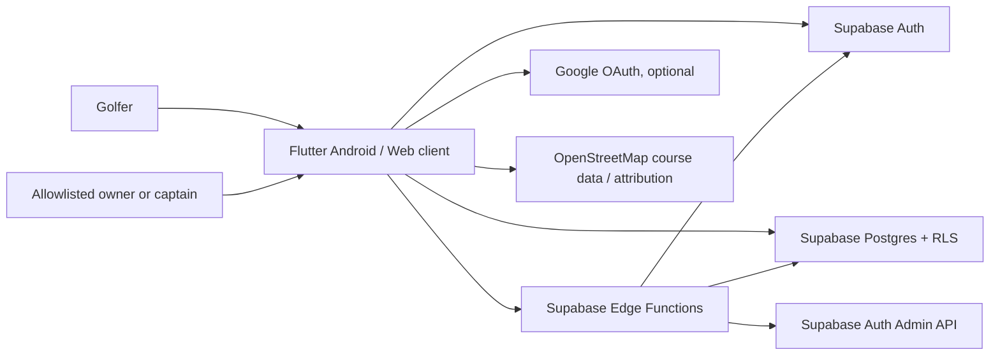

# Christian Golfers Cape Town — Architecture

**Document status:** implementation architecture, 29 October 2026

**Repository:** `vdiedericks6-sudo/ChristianGolfersCT`

**App identity:** Flutter package `christian_golfers`; Android application ID `com.christiangolfers.capetown`

**Backend:** Supabase project `cegmyadsnrvzlgpwoezu` (`https://cegmyadsnrvzlgpwoezu.supabase.co`)

## 1. Purpose and scope

Christian Golfers Cape Town is an independent Flutter application for golfer profiles, South African course discovery, golf rounds and scorecards, league standings, and member fellowship. It has its own source repository, Flutter package, Android application ID, assets, and Supabase project. It is not a Divot module.

The product supports password-based email accounts, so a Google account is not required. Google sign-in is an optional provider and depends on OAuth configuration in Supabase. The app has an in-memory demo backend for previews and a Supabase-backed live mode.

## 2. System context

The Flutter client holds only the project URL and publishable key. Supabase service-role/secret keys are server-side Edge Function secrets and must never be compiled into the app or committed to Git.

## 3. Client architecture

| Layer | Implementation | Responsibility |
|---|---|---|
| App bootstrap | `lib/main.dart`, `lib/app/app.dart` | Configure Flutter, Supabase, themes and root app |
| Navigation | `lib/app/router.dart` | GoRouter routes, stateful bottom navigation, nested feature flows |
| State | Riverpod providers | Auth state, profile, courses, round data, scorecard and admin dashboard |
| Feature UI | `lib/features/*/presentation` | Auth, home, courses, play, rounds, scorecard, leagues, fellowship, profile and admin screens |
| Feature data | `lib/features/*/data` | Supabase repositories, RPC and Edge Function calls |
| Domain | `lib/features/*/domain` | Profiles, round summaries, handicap and league calculation models |
| Shared core | `lib/core/*` | Theme, config, reusable widgets, auth abstractions and demo backend |
| Static datasets | `assets/data` | Bundled South African course, hole and driving-range data |

Navigation includes Profile, Privacy, Courses, Round Lobby, Live Round, Scorecard, Round Leaderboard and Admin Portal flows. In-app feature pages use the shared back button and system navigation. The bottom navigation is Home, Courses, Leagues, Fellowship and Profile.

The Play Golf → New Round action switches to the Courses stateful-shell branch rather than pushing a second Courses page onto another navigator. Daily scripture is selected deterministically from the local calendar date and refreshes at midnight or when the app resumes.

### Runtime modes

- **Live:** default build; Supabase Auth and database. `SUPABASE_URL` and `SUPABASE_PUBLISHABLE_KEY` Dart defines can override safe public defaults.
- **Demo:** `--dart-define=CHRISTIAN_GOLFERS_DEMO=true`; seeded in-memory data for UI preview, no account or network.
- **Web:** same Flutter feature tree, with conditional URL strategy configuration.

## 4. Authentication, authorization and sessions

Supabase Auth supports email/password. Auth sessions persist through the Supabase Flutter client for subsequent launches. Optional Google OAuth returns through `com.christiangolfers.capetown://login-callback`; Supabase provider credentials and redirect allowlists are configured in the project, never embedded as secrets.

An ordinary authenticated account is not an administrator. Admin authorization is checked against `public.admin_allowlist` by protected database functions/policies and server-side Edge Functions. The intended primary league administrator is `vdiedericks6@gmail.com`; its Supabase Auth user UUID must remain allowlisted. The app does not store a hard-coded admin password. Administrators can invite/onboard members through the `admin-invite-member` Edge Function.

RLS is enabled for exposed application tables. Database RPCs that cross row boundaries have explicit grants and authorization checks. The allowlist is intentionally not directly readable by client roles. The admin dashboard supports standings, round filters and details, member listing/invites, and a privacy request inbox.

## 5. Supabase backend

### Services

- **Auth:** password accounts and optional Google identity.
- **Postgres/Data API:** profile, course, round, scoring, league and social data, protected by grants and RLS.
- **Edge Functions:** `admin-invite-member` for allowlisted onboarding; `account-center` for public policy/request pages and account deletion operations.
- **Realtime:** round and score updates where the feature provider subscribes; the admin dashboard also refreshes on demand and on a periodic interval.

### Core data concepts

The migrations define profiles and `admin_allowlist`; courses, holes, tee boxes and tee-box hole distances; rounds, round players, hole scores and round results; leagues/seasons/standings; and fellowship/friendship data. The exact normalized column definitions and constraints are the executable source of truth in `supabase/migrations/`.

Live catalog snapshot recorded 29 October 2026: **361 course records, 828 hole records, 2 profile rows, 0 rounds, 0 hole-score rows, and 1 allowlisted admin**. Hole records cover 52 courses: 36 with 18 holes and 16 with nine. The catalog is not yet a verified complete national directory. Most course records do not have official tee-box yardages, course ratings or slope ratings; the app labels estimated GPS distances as estimates and does not present them as official scorecard yardages. See `COURSE_DATA_STATUS.md`.

### Handicap and round results

For each player/tee, course handicap is derived from Handicap Index, tee slope and course rating, using the configured course par and the World Handicap System style conversion used in the app. Course handicap strokes are allocated to holes according to stroke index. A completed round stores gross strokes, handicap-adjusted net score and placing. Scorecard inputs include strokes and supporting stats such as putts, penalties, sand shots, fairway result and greens in regulation. League points are separate from gross/net score; the supplied historic League A/B images do not define the historical points formula, so those totals must not be inferred from screenshots.

### Data access boundaries

- Ordinary users read/write only rows permitted by membership/ownership RLS.
- Round participants share their round scorecards with their playing group.
- Allowlisted owners/captains can read cross-member league, round and score views via guarded RPCs.
- Service-role credentials are used only in Edge Functions.
- `account-center` has platform JWT verification disabled so public GET policy pages and external deletion/contact forms are reachable. It validates bearer JWTs itself for in-app deletion and administrator deletion. The public submission action is limited to validated, bounded request inserts; it cannot delete accounts or inspect league data.

### Account deletion and privacy request handling

Profile → Privacy & account offers in-app deletion after a confirmation that describes the effect. The function validates the current session, deletes the Auth user, and removes the user’s privacy requests. Database foreign-key cascades remove the profile-linked friendships, memberships, hole scores and results. Deleting a host profile cascades to hosted rounds and therefore all associated records for every player in those rounds.

The public `account-center?view=delete` page allows a former user to request deletion without the app. It stores a minimal request in `privacy_requests`; an allowlisted administrator verifies control of the email address before processing it from Admin → Privacy. The page also serves the privacy policy and privacy contact form. Closing a request redacts the email and message. The inbox is admin-only and does not currently send an email notification; administrators must check it in the app.

Public policy URLs:

- `https://cegmyadsnrvzlgpwoezu.supabase.co/functions/v1/account-center?view=privacy`
- `https://cegmyadsnrvzlgpwoezu.supabase.co/functions/v1/account-center?view=delete`
- `https://cegmyadsnrvzlgpwoezu.supabase.co/functions/v1/account-center?view=contact`

## 6. Courses and guidance

The bundled dataset is for discovery/seed support; live course and hole records are stored in Supabase. Tee colours supported by the feature include White, Yellow, Blue and Red. A live catalog check on 29 October 2026 found 0 course photo URLs, 0 hole photo URLs and 0 per-tee hole distance records. The UI displays club-provided/licensed images and official distances when present and marks missing photos and estimates clearly. Images and official distances must be sourced from course owners or other licensed/verified sources. OSM tee/green coordinate distance is only a straight-line estimate. Shot suggestions use the golfer-selected lie and measured distance and are general guidance, not live weather, hazard or course strategy data. OpenStreetMap data requires attribution where displayed.

## 7. Notifications and wearable delivery

`AppNotificationService` initializes `flutter_local_notifications` and posts Android/iOS local notifications. Android declares `POST_NOTIFICATIONS`; Android 13 and later require the golfer to grant runtime notification permission. The Notifications page reports permission state, requests it, opens Android app notification settings, and can send a local test alert. Tapping a round alert deep-links to that round's live scorecard.

At present, round-start alerts are generated only for a golfer who has the round lobby open when another participant starts the round. They are not remote push notifications and will not reliably arrive when the app is closed or the lobby is not active. No Firebase Messaging/FCM project configuration or server-side push sender is present. Production background alerts require a Firebase Android app configuration, a push token registration design and a trusted server-side sender (for example a Supabase Edge Function using FCM credentials held only as server secrets), plus opt-in and token revocation handling.

On Android, ordinary phone notifications can be bridged to a paired Wear OS watch by the Android/wearable notification system; the user must allow app notifications and enable notification sharing in the watch companion settings. The app does not have a Wear OS companion app or watch-specific data layer. Actual watch delivery must be verified on a paired watch and depends on its notification settings and connection.

## 8. Assets and visual identity

Official Christian Golfers Cape Town branding is provided from `assets/images/cgct_official_logo.jpeg` and reusable logo widgets. Welcome/home/courses visuals use the user-provided Cape Town golf imagery under `assets/images/`. The scorecard follows the dark navy and lime visual direction of the provided scorecard reference; score entry and round summary remain native Flutter widgets rather than an embedded screenshot.

## 9. Android build and release

- Flutter project root: repository's `ChristianGolfersApp` directory.
- Android namespace/application ID: `com.christiangolfers.capetown`.
- SDK levels follow the installed Flutter SDK (`compileSdk`, `targetSdk`, `minSdk`); the release gate is target API 36 for new apps/updates after 31 August 2026.
- Build version is `1.0.0+1` in `pubspec.yaml`; increase build number for every Play upload.
- Debug APK path: `build/app/outputs/flutter-apk/app-debug.apk`.
- Play artifact: signed Android App Bundle (`flutter build appbundle --release`).
- Release signing reads ignored `android/key.properties`; the signing keystore and passwords must be privately created, backed up and never committed. A debug install does not validate Play signing.
- CI/release commands and the owner checklist are in `docs/google-play-release.md`.

## 10. iOS provisioning status

Flutter source can target iOS, but iOS provisioning is not complete. A macOS host with current Xcode, Apple Developer team, registered bundle identifier, signing certificate/profile, App Store Connect app record, privacy nutrition labels, and a physical-device/TestFlight build is required. Android keys cannot sign an iOS app. Confirm Apple team ownership and bundle ID before provisioning.

## 11. Operational configuration and ownership

Supabase project ownership, Auth provider setup, SMTP delivery for Auth invitations/password recovery, Auth leaked-password protection, Edge Function secrets, admin allowlist, course-source licenses, and production release credentials are operational settings. They are not recoverable from Flutter client code. The project has an Auth leaked-password-protection advisor warning that should be resolved in Supabase Auth → Password Security before launch. Test invitation and password recovery delivery with the club's production SMTP configuration.

## 12. Known limitations / decision log

1. Course directory and official tee data are incomplete; do not claim every South African course or authoritative course handicap until source coverage and ratings are verified.
2. Historical League A/B totals are visible as supplied standings, but no points algorithm was supplied; new points scoring requires the owner to specify a formula.
3. Public privacy requests are queued for administrator review without notification. Establish a routine inbox review or add a monitored notification channel before broad launch.
4. The current sample count is a snapshot and should be refreshed before a release or architecture revision.
5. Admin secrets are not in the app. Allowlisting controls admin access; a pre-release username/password is not a safe client-side mechanism.
6. Phone local notifications and Wear OS notification bridging are implemented, but remote notifications while the app is closed require FCM and trusted server configuration.
